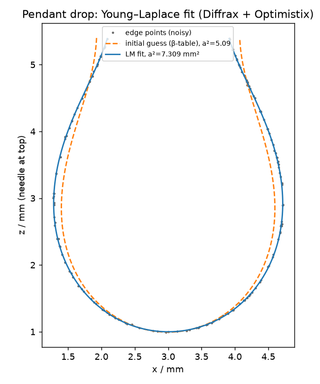

# bashforx

Pendant-drop tensiometry à la **Bashforth & Adams (1883)**. The axisymmetric
Young–Laplace equation is solved with [Diffrax](https://github.com/patrick-kidger/diffrax)
and fitted to a drop's edge points by Levenberg–Marquardt with
[Optimistix](https://github.com/patrick-kidger/optimistix). The result is
`a² = γ / (Δρ g)`, the surface tension relative to specific gravity.



## The model

Bashforth & Adams wrote the profile in terms of arc length. Here *s* runs from the
apex, *z* points up towards the needle, and φ is the angle of the tangent:

```
dx/ds = cos φ
dz/ds = sin φ
dφ/ds = 2/b − c·z − sin φ / x        c = Δρg/γ = 1/a²,  β = c·b²
```

*b* is the radius of curvature at the apex, and β is Bashforth & Adams' shape factor.
At the apex, sin φ / x tends to 1/b. The right-hand side uses a double `jnp.where`
there, so neither the value nor its forward-mode derivative becomes NaN.

## Fitting

* The unknowns are `(b, c, x0, z0)` plus one **signed arc length per observed point**.
  Points left of the axis take negative values, using the symmetry
  x(−s) = −x(s) and z(−s) = z(s). The residual is `model(sᵢ) − pointᵢ`. That is
  smooth, so Levenberg–Marquardt applies directly. The alternative, distance to the
  nearest point on the curve, is not smooth.
* Each residual evaluation does one ODE solve with dense output, and then
  `sol.evaluate(|sᵢ|)` is vmapped over the points.
* **`adjoint=diffrax.ForwardMode()`** is required. Optimistix's least-squares
  solvers build Jacobians in forward mode, and Diffrax's default
  `RecursiveCheckpointAdjoint` supports only reverse mode.
* The starting point mimics a lookup in Bashforth & Adams' tables. A quadratic
  fitted to the bottom of the drop gives the apex and *b*. A grid search over β
  then picks the closest shape.
* Uncertainties come from the linearised covariance σ²(JᵀJ)⁻¹.

## Install

With [uv](https://docs.astral.sh/uv/):

```bash
git clone https://github.com/gdmcbain/bashforx
cd bashforx
uv sync --all-extras
uv run pytest
uv run examples/demo.py
```

To use it from another uv project: `uv add git+https://github.com/gdmcbain/bashforx`.

## Usage

```python
import bashforx as bfx

points, _ = bfx.synthetic_drop(b=1.6, capillary_length_sq=7.35, noise=0.005, seed=0)
fit = bfx.fit_drop(points)  # points: (N, 2) array of (x, z), z up towards the needle

fit.capillary_length_sq, fit.capillary_length_sq_std  # a² and its 1σ, in data units²
fit.params.b, fit.b_std                               # apex radius
fit.surface_tension(998.0)                            # γ in N/m, for Δρ in kg/m³ and data in mm
```

Edge points taken from an image usually have *y* pointing down, so flip it first.
`fit_drop` raises `RuntimeError` if Levenberg–Marquardt does not converge, or if
it converges to an unphysical shape (b ≤ 0 or c ≤ 0).

Importing `bashforx` turns on JAX's 64-bit mode.

## Example

`examples/demo.py` fits a synthetic water drop (150 points, 5 µm noise):

| | Fitted | True |
|---|---|---|
| *b* (apex radius) | 1.5985 ± 0.0008 mm | 1.6 |
| *a²* = γ/(Δρg) | 7.309 ± 0.017 mm² | 7.35 |
| γ (Δρ = 998 kg/m³) | 71.5 mN/m | 72.0 |

The quoted uncertainties hold up over many noise seeds. Across 40 seeds, the error
divided by its reported σ averaged 0.03 with a spread of 1.10.

## Status

So far it has been tested only on synthetic drops, not on edge points from real
images.

## Reference

F. Bashforth & J. C. Adams (1883). *An Attempt to Test the Theories of Capillary
Action by Comparing the Theoretical and Measured Forms of Drops of Fluid.*
Cambridge University Press. This is also where the Adams–Bashforth multistep
method first appeared, as the way Adams integrated this same equation.

## License

Apache-2.0, the same as Diffrax and Optimistix.
